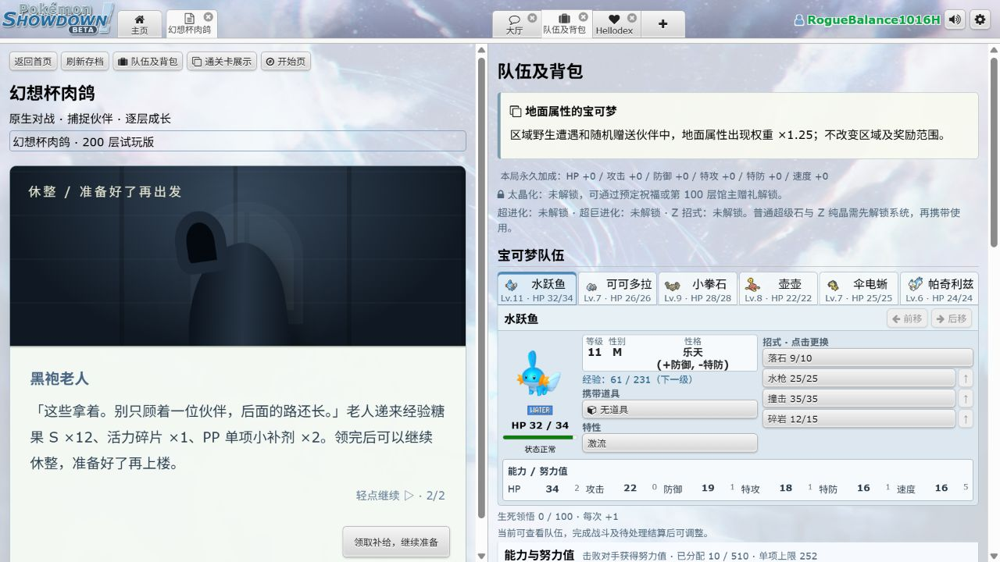

# 幻想杯肉鸽：前期成长调整与祝福强度复核

> 历史评估记录：本文保留第一轮方案及当时的实测结果。用户随后重新校准了免费补给、后备经验和祝福强度，当前规则以 [2026-10-16 校准落实记录](FANTASY-ROGUE-RECALIBRATION-2026-10-16.md) 为准；下文旧数值与建议不再代表当前版本。

更新日期：2026-10-16。评估基准为**无塔灵、无局外能力加点**。本轮目标是前中期较轻松，中后期逐渐提高难度；幻想精英可以形成关卡，但玩家应提前获得提醒和准备资源。

## 结论先说

单纯增加精英战后的掉落，不能解决“先打不过精英”的问题。本轮同时增加了**战前补给、落后队员的经验分享、前期事件糖果、实用学习机和早期携带道具**。精英战后的额外奖励用来支持下一段成长。

目前最值得优先补强的祝福是「这才叫看穿」「就决定是你了」以及「愤怒的普通宝可梦」。最值得限制的组合是「可再生资源」搭配回复树果／触发型强化道具，以及「电气鼠大家族」的多道具共享。这些祝福的改动建议仅列在本报告中，**本轮没有擅自削弱已确认的效果**。

三种“命运”已按最新要求修正为**同品质随机祝福＋资源**。之前文档与实现的“三种都送黄金”已替换。

## 已经实装的调整

### 1. 首领前提醒与补给

每个固定休整点都会遇见开场的黑袍老人。两页简短对话说明下一层有强敌，幻想精英层会特别点明；已经选择祝福时，还会显示其累计增加的固定首领等级。最后领取糖果、1 个活力碎片、2 个 PP 单项小补剂。

领取后停留在宝可梦中心，可继续治疗、学习招式、进化和购物；仍须玩家自行点击进入下一层、开始战斗。跳过对话照常领取，同一休整点不能重复领取，重新连接也不重复发放。

| 休整楼层 | 每名队员对应的糖果 | 六人队总量 | 主要用途 |
| --- | --- | --- | --- |
| 9 | S ×2 | S ×12 | 第一个幻想精英前补级 |
| 19 | S ×3 | S ×18 | 首个道馆前巩固队伍 |
| 29 | M ×3 | M ×18 | 第二个幻想精英前追级 |
| 39 | M ×4 | M ×24 | 中前期进化、补齐后备 |
| 49、59 | M ×5 | M ×30 | 50 层祝福和后续首领的难度上升 |
| 69 | M ×3 | M ×18 | 开始收缩补给力度 |
| 79、89、99 | L ×1 | L ×6 | 中段过渡 |
| 100 层后的每个固定休整点 | 全队合计 L ×2 | L ×2 | 保留少量补给，不持续推高整队等级 |

人数按领取时队伍计算，最少按 2 名、最多按 6 名。糖果放入背包，由玩家决定给谁，**不会自动分配**。29～59 层数量是在本轮第一次 30 层实测后进一步提高的最终值。

第一个幻想精英的实际努力值是六项全 0，并不是满努力值。因此没有制造一份“减半后反而变强”的配置；本轮改为基础等级 **10→8**，其他固定精英的原配置不变。加上开局祝福后，该精英分别是白银 8 级、黄金 13 级、棱彩 18 级。

### 2. 成长与奖励

| 项目 | 最终规则 |
| --- | --- |
| 存活后备成员经验 | 1～60 层为参战完整份额；61～100 层为 75%；101 层起恢复原本 50%。经验资格和参战成员的原公式不变。 |
| 1～30 层区域精英／固定幻想精英 | 原掉落外，追加珍珠 ×1、S 糖果 ×2；珍珠可兑换 600 金币。 |
| 31～70 层区域精英／固定幻想精英 | 原掉落外，追加大蘑菇 ×1、M 糖果 ×1；大蘑菇可兑换 1500 金币。 |
| 1～19 层正面事件 | 原奖励外追加 S 糖果 ×1。 |
| 20～39 层正面事件 | 原奖励外追加 S 糖果 ×2。 |
| 40～79 层正面事件 | 原奖励外追加 M 糖果 ×1。 |
| 成功完成事件战斗 | 上述事件追加糖果翻倍。 |

主动离开、事件战败、负面结果不追加糖果；“旅行的回忆”的幻境战斗不领取这份战斗补助，保留原先约定的恢复和收益规则。80 层起停止这项前期事件补助。普通野怪掉落与后期精英掉落没有一并膨胀。

### 3. 交易与商店

以下是**已经出现交易点之后，交易店种类的分布**，不是交易区域占全部路线的概率：

| 楼层 | 经验糖果店 | 招式学习机店 | 薄荷店 |
| --- | ---: | ---: | ---: |
| 1～40 | 50% | 40% | 10% |
| 41～80 | 40% | 40% | 20% |
| 81～200 | 34% | 33% | 33% |

学习机店在 80 层前最多展示 **6 种**，80 层起 **8 种**。前四项优先从实用招式中产生，包括命中较稳定、威力合适且与队员攻击能力相符的伤害招式，以及回复、强化、保护、状态干扰等。仍要求队内有伙伴合法可学且尚未掌握；候选不足时按实际数量展示，不凭空突破招式合法性。商品进入店铺时保存，刷新页面不会重抽。

| 糖果 | 经验 | 开放条件 | 售价 | 每店库存 | 每金币经验 |
| --- | ---: | --- | ---: | ---: | ---: |
| XS | 100 | 开局 | 80 | 3 | 1.25 |
| S | 800 | 开局 | 380 | 3 | 2.11 |
| M | 3000 | 29 层起 | 1350 | 2 | 2.22 |
| L | 10000 | 79 层起 | 4200 | 2 | 2.38 |
| XL | 30000 | 119 层起 | 12000 | 1 | 2.50 |

29／79／119 是固定休整层，实际随机糖果店会在之后的普通层出现。以上为无塔灵价格；高品质糖果的单位经验更便宜，高阶糖果延后上架，也不能无限购买。

奇迹种子、神秘水滴、木炭等 **18 种属性增强道具提前到第 9 层休整商店**，每件 3000 金币。早期已有可靠装备可以购买，讲究系列等其他装备不随之提前。

### 4. 命运与明确的体验问题

- 白银／黄金／棱彩命运分别赠送白银／黄金／棱彩祝福；第 1 和 50 层额外金币为 800／1000／1200，100 层翻倍、150 层三倍。赠送结果遵守楼层和互斥条件，不再抽命运，不重复增加等级。
- 野怪单打后备决策排除了没有队友目标的「帮助」等招式；这是修正明确的无效操作，并非宣布所有 AI 决策都已完善。
- 新增祝福的图鉴图标与局内选择图标使用同一映射，减少统一星形占位。异常状态名称及捕捉成功提示中的物种名称补齐中文显示。
- 交易说明改成与真实库存一致；奖励处理页使用“旅途奖励”，不会把事件奖励误写成普通祝福轮次。
- 形态交换结束后提供明确的“回到摊位”；奇遇图鉴空白处标明内容仍在制作；不可操作的主按钮有禁用外观。

## 实测和推算分别说明

### 本地实际对局

使用独立测试昵称，不修改用户原存档，不注入等级、金币、胜负或随机数。对局由本地正常服务和真实战斗引擎运行；部分操作用游戏正常协议自动执行，老人对话、领取补给和第 9 层道具上架用实际客户端核验。

第一轮样本 H：无塔灵、无局外加点，水跃鱼开局、地面偏爱卡，开局从实际随机选项中选了棱彩「诸武精通」。第 9 层补给前队伍为 6～11 级；使用补给后 12～15 级，第 10 层面对 18 级幻想精英，3 回合获胜、无人倒下。第 20 层道馆 9 回合获胜、倒下两名。

这个样本在第 30 层被 30 级太晶水幻想冷水猿击败。队伍为 24～25 级，岩石／地面成员多，没有足够强的水系反制；自动策略还让四倍弱水的隆隆石首发。不能把自动策略的失败全部归因于数值，也不能忽略这段仍有风险。最终版本因此增加了 29～59 层的糖果，并补充祝福加级提醒。样本 H 已领取的旧补给不追溯重发。

第二轮样本 I 使用最终方案：妙蛙种子开局、火属性偏爱卡，开局选择随机出现的「棱彩命运」，实际得到「灵能百分百」和 1200 金币。存档中的固定首领加级合计为 +10，没有把赠送祝福再算一次。

| 楼层 | 样本 I 的实际结果 | 需要注意 |
| --- | --- | --- |
| 10 | 对 18 级幻想大岩蛇，首次 5 回合失败、四名倒下；复活后用灵能，1 回合获胜。 | 没有隐去首次失败；开局彩色代价仍能形成明显门槛。 |
| 20 | 对 25 级亚莎队伍，8 回合获胜、两名倒下。 | 使用过灵能。 |
| 30 | 对 30 级幻想尖牙笼，1 回合获胜。 | 灵能直接处理了首领，不能拿它证明单靠等级已经足够。 |
| 40 | 对 35 级道馆队伍，11 回合获胜、一名倒下。 | 使用过灵能。 |
| 50 | 对 40 级幻想蝶结萌虻，5 回合获胜、两名倒下；之后选白银「战斗，爽」。 | 本场没有使用灵能。队伍为 34～35 级。 |
| 60 | 对 45 级阿塞萝拉队伍，8 回合失败、六名倒下；仅复活一名后的重试也失败。 | 灵能被未破除的画皮挡住；队伍 34～43 级，后备培养不均，缺少有效的幽灵反制。 |

样本 H 的 33 场普通野战全部不超过 3 回合，无队员倒下；样本 I 的 96 场普通野战中，84 场不超过 3 回合，中位数为 2 回合，合计倒下 6 次。**普通路线更顺滑已有实际证据；首领的难度仍有明显波峰，尚不能据此宣称所有前中期配队都轻松。**

自动策略会按等级选首发、较少主动换人，频繁用新捕获成员替换已培养成员；会先给存活成员喂糖，再到中心复活，也没有合理购买学习机和属性装备，并购买了过多精灵球。这些都会压低测试表现。60 层失败主要暴露了准备与对战策略的代价，不应单凭这个失败继续加糖果。后续更有价值的验证是让会破画皮、会保留克制招式、会均衡培养的玩家操作同一阶段。

本轮使用正常协议，未修改测试账号的等级、金币、随机数或胜负。摘要及首领原始战斗日志已保存于 [live-summary.json](docs/playtests/2026-10-16/balance/live-summary.json)。**本报告不把少量样本当作通关率，也不声称已经人工完整打通调整后的 200 层。**

### 同条件成长测算

另用实际经验曲线、生态池、固定首领配置进行了 24 个种子、两种分配方式、调整前后共 **96 条成长轨迹**的离线测算。无塔灵、无局外加点、无升星；每轮用黄金祝福的等级代价，暂不加入祝福正面效果，不购买糖果。普通十层固定取五次野战、一次精英、一次正面事件、一次奖励。

这是假设战斗全部获胜、队员存活的**资源供给测算**，不是战斗胜率模拟。按固定时间招募、缺省不计算捕捉失败与战败，所以只能说明“这些奖励是否有能力补上等级”，不能代表真实玩家平均进度。

| 首领前楼层 | 调整前平均等级 | 最终方案平均等级 |
| --- | ---: | ---: |
| 10 | 8.3 | 16.3 |
| 20 | 11.4 | 19.0 |
| 30 | 15.8 | 26.3 |
| 40 | 19.7 | 32.7 |
| 50 | 24.2 | 38.7 |
| 60 | 28.3 | 43.8 |
| 80 | 38.5 | 51.3 |
| 100 | 46.8 | 58.7 |
| 150 | 70.0 | 75.7 |
| 200 | 93.2 | 96.2 |

表中按“优先给最低等级伙伴”分配糖果，数值为各种子队伍平均等级的中位数。早中期提升明显，后期收益逐渐收敛；首领原配置、后续祝福等级代价与玩家等级上限继续形成后段压力。若将糖果全部喂给主力，仍会出现较大的队内等级差，这不能靠掉落增加自动消除。

## 哪些祝福值得补强

这里的“偏弱”指占用一个选择机会后，常规收益低，也很难靠搭配产生足够明显的变化，不是看到条件苛刻就判弱。

| 优先级 | 祝福 | 主要问题 | 建议方向，尚未修改 |
| --- | --- | --- | --- |
| 高 | 银·这才叫看穿 | 先占一个招式位，再花一回合看穿，收益只在紧接的一回合生效。常规招式要害率由约 4.17% 到 50%，通常只是下一击约 25% 的平均伤害收益，遇到继续防守、换人或不能出招就失去窗口。与另一个要害等级来源配合可以必定要害，但仍是很窄的一击窗口。 | 改为成功看穿后“下一次伤害招式必定要害”，允许跨过非攻击回合；不增加新的循环叠层。 |
| 高 | 银·就决定是你了 | 要先满亲密度，再培养约 25～30 层，最终只惠及初始伙伴。最大伤害浮动相对平均浮动约多 8.1%，保命又只有 10% 概率；养成时间与稳定收益不相称。 | 保留羁绊主题，分阶段开放收益；满羁绊将随机保命改为一次可靠保命，或明显缩短第二段等待。需要一并避免与“留得青山在”完全重合。 |
| 高 | 金·愤怒的普通宝可梦 | 全队原始种族值必须都不超过 500；回报主要是 20%／30%／40% 经验及战利品，没有直接战力。选它却立即承担黄金首领等级代价，后期经验接近上限后收益再下降。本轮增加基础补给后，它的相对价值进一步降低。 | 降为白银，或保留黄金并给符合条件队员一个稳定的直接战斗收益；避免只是再加经验。 |

建议观察，但暂时不直接定为“下限、上限都低”：

| 祝福 | 为什么值得观察 | 为什么不直接判废 |
| --- | --- | --- |
| 金·加时赛（天气、场地版本） | 野怪战通常短，原本 5 回合已经够用；延长不能阻止敌人覆盖环境。 | 长首领战、戏法空间和顺风版本有实际战术价值，应按具体版本判断。 |
| 金·金金金金钱钱钱钱 | 相同楼层只比白银金币祝福多一份钱，却承担黄金代价。 | 早期可立即换关键装备，经济紧缺和不同价格阶段的价值不同。 |
| 金·潘多拉的装备 | 相对银版新增主要是两个工具箱，不是新战斗机制。 | 工具箱可选到关键道具；与装备型祝福有配合，不能忽视高价值结果。 |
| 金·带资进组 | 正常少量捕捉时，金币回报可能不足以补偿等级代价。 | 与“我收服，宝可梦了”“入职火箭队”、收集家族队有明确配合。 |
| 彩·濒死悟道 | 第一次需要累计 100 次相关行动；晚拿回本慢，复活也消耗资源。 | 后续领悟效率会提高，不能只看第一次触发时间就认定没有上限。 |

这些不应当因“单独看不强”而削弱或删除：灌铅骰子＋命运决定一切；这才是游击＋进球休息＋闪亮再登场；越打命越硬＋飞身重…踢？；林间大合唱＋全队开麦；简单，我学，我会＋诸武精通；头孢＋酒。它们都存在明确的组合价值。

## 哪些强度明显偏高

### 最优先：可再生资源

黄金品质却作用于全队、以后入队也适用。问题不只是省钱，而是把原本“一场一次”的机制变成可重复发动：回复树果、弱点保险、强力香草等会改变整个对局结构。

原生引擎对照：640 HP 的幸福蛋携带文柚果，每回合受到 100 点固定伤害。没有祝福，第 8 次攻击倒下；有可再生资源，第 10 次攻击后仍有 **440 HP**。这是控制伤害的效果验证，不代表任何对手都打不死它；爆发、拍落、禁回复等仍能处理。

建议优先限制“重复触发的次数或范围”，例如每件道具每场额外恢复一次，或把回复树果／强化道具单列。单纯升为棱彩未必能解决机制问题，也会让敌方等级代价更重。本轮保留原效果，等待选择调整方向。

### 成型后过强：电气鼠大家族的共享装备

六只电气鼠是实在的成型门槛，但完成后电气球、讲究头带、讲究眼镜、讲究围巾等同时作用，使原本互斥的装备收益叠在一只身上。

原生引擎验证，样本皮卡丘面板攻击 135、特攻 125、速度 205，共享上述装备后实际攻击 **405**、特攻 **375**、速度 **307**，即双攻三倍、速度约 1.5 倍，还能同时拥有剩饭。讲究锁招仍在，同名道具不重复，变身专用道具不共享；这些限制没有消除多装备叠加的核心优势。

再配可再生资源会进一步放大。可考虑限制共享效果数量，或给电气球的“共享版本”单独系数；但这涉及此前明确确认的家族特色，不能作为普通 bug 修复直接删掉。

### 强力组合：异常大满贯＋曼陀罗饮品

毒和剧毒可以叠加，毒伤再翻倍，绕过属性免疫后会对高耐久目标产生很强的百分比杀伤。

原生引擎样本：对无防护特性、无治疗的 640 HP 幸福蛋，第一回合施加中毒、第二回合追加剧毒。只有异常大满贯时，前三回合末 HP 是 **560→440→280**；加上曼陀罗饮品后变为 **480→240→0**。实际对战仍要成功施加两个状态，且会受到特性、场地、神秘守护、治疗与转阶段清理等限制。

建议先观察首领被这套组合处理的比例，再决定限制同一时点的多种持续伤害，或仅让一种毒状态享受翻倍；不要取消用户明确要求的“中毒与剧毒可共存”。

### 极高上限但属于已确认设计：还没打完呢

三旋击按 20／40／60／80／100／120 结算，总威力 **120→420**，不是一般多段招式的简单翻倍。原生固定伤害随机值、强制命中的同目标验证中，伤害从 **42→145**，约 3.45 倍，差别来自逐段取整。

正常每段 90% 命中时，六段全中约 53.1%；逐段中断的期望基础威力为 **94.14→269.45**，约 2.86 倍。命中保障会进一步推高收益。

这是此前明确接受的 420 设计，不能称为实现错误。建议作为高强度组合保留并重点观察，优先解决可再生资源这类较低门槛的重复触发问题。

### 其他值得警惕的上限

| 祝福／组合 | 关注原因 | 当前判断 |
| --- | --- | --- |
| 聚集的祈愿→Top Clear Mind | 全队所有招式先制度 +1，包括控制、回复和强化；低速队也能改变行动顺序。 | 强，但需要两轮祝福以及队伍条件。应先测试控制链，不直接视为免费常驻速攻。 |
| 猜猜下一招 | 胡帕专属伤害加成之外，还会调用队伍招式；精心安排招式池可以获得很强的单回合收益。 | 高上限专属构筑，值得独立测试调用池，不等同于普遍超模。 |
| 大力士？大法师！ | 一只核心成员双攻择一翻倍，与装备及不同来源增益叠加。 | 彩色核心奖励本就应强；固定一名成员、属性克制和先手风险仍是代价。 |
| 属性进化 | 长期强化、50% 附效、要害 +2、属性关系修改能形成质变。 | 后续三轮都承担彩色代价，不能只看最终强化而忽略机会成本与敌方加级。 |
| 越打命越硬＋飞身重…踢？ | 最大 HP 2500 时处决线达到 100%；实际造成伤害后即可处决。 | 属于用户接受的罕见成型终局，所需击倒数／星级／槽位不能忽略；本轮不加上限。 |

## 后续优先级与验证边界

1. 先继续观察 30、50、60 层，区分等级不足、没有有效招式、队伍弱点集中，以及自动操作失误。不能为了让任意配队都获胜，把精英的特色也抹掉。
2. “可再生资源”的重复触发优先级高于普遍削弱棱彩祝福；先降低低门槛无限收益，再保留需要构筑和运气的强组合。
3. 糖果数量增加后，批量使用和给落后成员的操作提示值得下一轮优化；本轮不自动替玩家分配糖果。
4. 尚未处理的体验项：生态与战斗背景匹配、Showdex 对复杂额外效果的展示核对、队伍长面板进一步收纳、未制作的奇遇内容。它们没有被算作“本轮已全部修复”。

本次清单共 **139 个祝福定义、80 个效果家族**（多个属性版本合并判断）。数据清单与量化结果在 [audit.json](docs/playtests/2026-10-16/balance/audit.json)，可用 `node tools/fantasy-rogue-balance-audit.js` 重现。成长测算、原生机制对照、真实本地对局和人工界面核验是四种不同证据，不能互相替代。

## 最终验证记录

- 肉鸽专项：**1822 项通过**，包括首层祝福、三个命运的同品质结果／互斥／等级代价、塔灵、剧情、事件、库存持久化、成长、最终首领、通关卡与约战等现有测试，以及本轮新增的前期补给测试。命令为 `node node_modules/mocha/bin/mocha.js --no-config --exit --timeout 15000 test/main.js "test/server/fantasy-rogue*.js" --reporter dot`。覆盖这些模块不等于穷举所有祝福组合。
- 客户端肉鸽测试：**99 项通过**。客户端构建通过；可选新闻抓取有 PHP 环境提示，不影响游戏构建。
- 服务端构建、TypeScript 检查、本轮新增文件与剧情文件的 ESLint 检查通过；两仓库 `git diff --check` 通过。TypeScript 检查为适配当前安装版本显式传入 `--ignoreDeprecations 5.0`，没有修改项目配置来隐藏业务类型错误。
- 曾执行全仓库测试，结果 **6230 项通过、79 项待执行、27 项失败**。其中两项肉鸽测试是默认 2 秒超时，之后在上述完整初始化、15 秒限时的肉鸽专项中通过；其余 25 项涉及通用数据检索、Dex 数据／数量、画皮及濒死 Mega 形态等，未在本轮处理，也没有证明它们均为改动前就存在的问题。因此不能说“全项目所有测试通过”。
- 另一次没有加载 `test/main.js` 的专项调用因缺少 Config／Users／Chat 初始化失败，已修正调用方式并完成上面的 1822 项检查，不把该次初始化失败当作游戏故障。
- 本地服务已备份存档后更新并启动，实际客户端确认了老人补给、保留准备阶段与第 9 层属性装备；正常 WebSocket 完成了测试账号的重连与继续游玩。用户原账号存档没有被测试覆盖。

调整已在本地可玩版本生效。本轮没有提交或推送远端。祝福补强／削弱部分为评估建议，除三种命运的纠正外，没有按本报告自行改动其他祝福强度。

