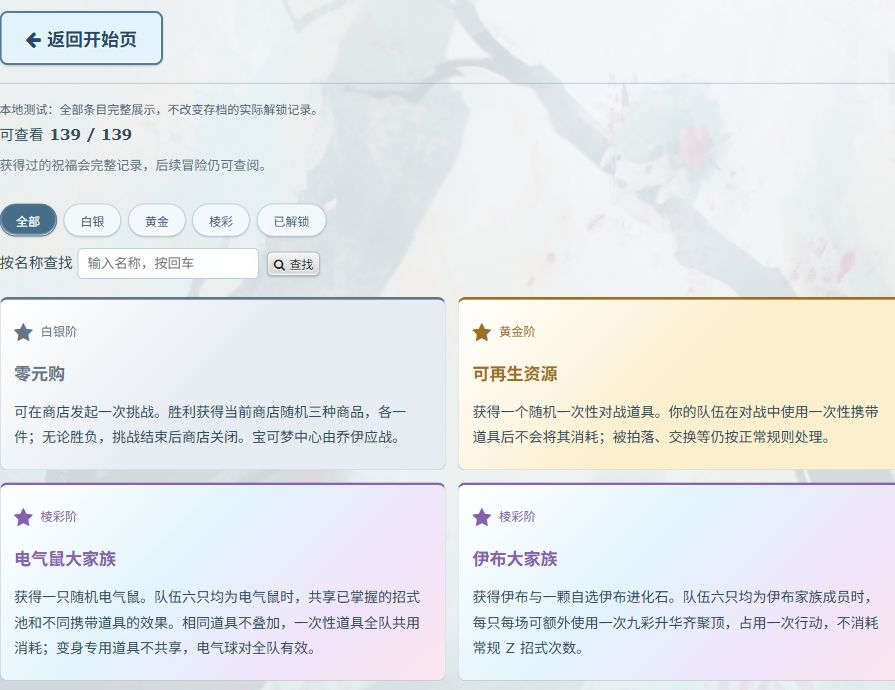
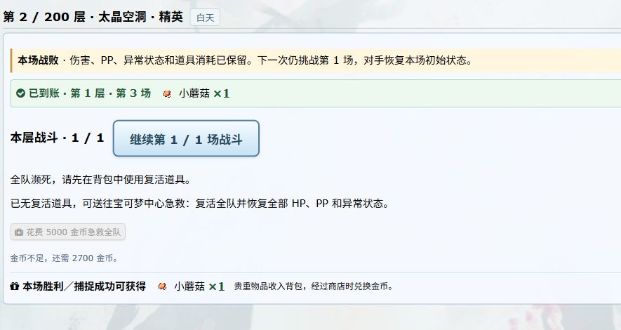

# 幻想杯肉鸽本地游玩体验报告

测试日期：2026 年 10 月 16 日。

**结论：核心玩法已经能够形成完整的前中期循环，但难度曲线、构筑成型速度和部分信息反馈还需要打磨。以零局外成长、没有提前规划成熟阵容的新玩家为参照，已体验的前中期难度暂评 8 / 10。这个分数不是完整 200 层的最终评分。**

本轮新建了 7 个独立测试存档，实际到达最远第 60 层，记录了 222 场真实对战、452 个回合。没有通关 200 层，因此第 61～200 层、最终超梦战、阿尔宙斯挑战及通关后的玩法不能写成已实测通过。以下明确区分实际体验、代码核对和仍待验证的内容。

## 1. 这次怎样测试

### 测试范围与方法

- 使用本地正在运行的肉鸽服务和实际客户端。开局、图鉴、捕捉、队伍界面、旅游事件等进行了浏览器操作和观察；重复战斗、选路、补给、进化等使用正常游戏协议辅助推进。
- 所有对手、随机结果、伤害、捕捉结果和资源消耗均由实际游戏产生。没有修改存档数值、跳层、强制胜利或指定随机结果。
- 对战辅助策略不等同于熟练玩家：早期出现过冒险投球、低血量强化、换人不当；后续虽然改善了策略，仍没有充分运用所有强化、换人、回复招式和配队组合。这会使失败偏多，不能拿这些存档计算真实玩家通关率。
- 各档起始均为零局外加点、一个初始栏位。D～G 档为了比较玩法，使用现有本地测试入口指定塔灵；正式新玩家仍需先无塔灵通关才开放塔灵。这几档不代表正式新玩家的开局条件。
- 本轮接触了无塔灵及 3 种塔灵，领取了 9 个不同祝福条目（包含命运赠送），进入了 7 种常规事件。没有穷举当前图鉴中的 139 个祝福及所有联动。
- 统计的 222 场不包含 A 档最初一场手动战斗和“斗蛐蛐！”的 AI 对 AI 观战场；战败后的重试按独立战斗计算。

### 七个存档的实际结果

| 档案 | 开局与塔灵 | 主要祝福 | 最远到达 | 记录的战斗 | 主要结果与局限 |
| --- | --- | --- | ---: | ---: | --- |
| A | 呆火鳄，无塔灵 | 白银命运 → 林间大合唱 | 2 层 | 4 场：2 胜、2 负 | 火系成员过多，过早挑战精英，在约 8.8% 捕捉率下继续冒险投球后团灭。主要反映错误选择的代价，不能据此断言第二层不合理。 |
| B | 呆火鳄，无塔灵 | 下一站，巨星 | 10 层 | 7 场：5 胜、2 负 | 主力 12 级、其余 6～7 级，遇到 15 级幻想稚山雀。没有有效培养任务赠送的晃晃斑，祝福的即时战力收益很低。 |
| C | 妙蛙种子，无塔灵 | 小心脚下 | 10 层 | 9 场：6 胜、3 负 | 较早在事件战受挫，后备成长落后。10 层对手为 15 级幻想向尾喵，不能只归因于等级差。 |
| D | 水跃鱼，伊裴尔塔尔的交易 | 宝可梦电进化 | 10 层 | 15 场：13 胜、2 负 | 首次挑战前全队满血，队伍 5～11 级，对手为 20 级幻想大岩蛇；6 回合团灭。棱彩的前期等级代价明显，但这不是所有棱彩构筑的结论。 |
| E | 呆火鳄，雷吉奇卡斯的试炼 | 预定幻想 | 40 层 | 58 场：56 胜、2 负 | 通过 10、20、30 层，在小刚处失败。三人队为 23 级炙烫鳄、19 级阿罗拉小拳石、17 级帕奇利兹，属性覆盖存在明显缺口。 |
| F | 水跃鱼，时拉比的驻时 | 留得青山在；50 层选可再生资源 | 60 层 | 87 场：85 胜、2 负 | 40 级固定等级赠送伙伴承担前期主力；后来通过事件转为阿罗拉臭臭泥。通过 50 层，60 层奇树战持续 24 回合后失败。 |
| G | 水跃鱼，雷吉奇卡斯的试炼 | 入职火箭队 | 40 层 | 42 场：41 胜、1 负 | 增加普通训练家路线后到达 40 层，败于阿塞萝拉。队伍仍只有 23 / 17 / 18 级，后备强度不足；本档没有实际投球捕捉 NPC，不能确认愤怒效果。 |

七档最后均出现全队倒下、没有复活道具且金币不足急救的情况，保留在现场供复查，没有擅自清档。三档无塔灵测试均未越过第 10 层，但样本少、操作策略不成熟，不能推出“正常玩家都过不了第 10 层”。

## 2. 难度怎样评分

评分含义：1 分接近轻松体验；5 分需要基本的属性、资源和队伍管理；8 分需要明确构筑及准备；10 分接近高度优化阵容、反复尝试才能完成。分数是体验判断，不是胜率换算。

| 已体验部分 | 难度暂评 | 原因 |
| --- | ---: | --- |
| 普通野生战斗 | 2～3 / 10 | 大多数结束很快，压力更多来自捕捉和累计损耗。强塔灵样本占比较高。 |
| 随机精英、事件战 | 4～7 / 10，个别早期组合可更高 | 主动承担风险的意味明确，但等级、属性克制和剩余补给的影响很大。 |
| 无塔灵新档的第 10 层固定精英 | 约 8 / 10 | 小队尚未成型，黄金或棱彩等级代价已经生效。长期任务祝福未必能及时转化为战力。 |
| 有强塔灵的 1～30 层 | 2～5 / 10 | 雷吉奇卡斯的输出与减伤、时拉比的 40 级伙伴能显著降低前段难度。 |
| 40 层馆主 | 约 7～9 / 10，取决于阵容与馆主 | 小刚、阿塞萝拉对本轮队伍形成强压力；另一档有 40 级主力，对露璃娜只打了 5 回合。不是同一条件下的馆主强弱对照实验。 |
| 50～60 层、第二轮黄金祝福后 | 本档约 9 / 10 | 奇树全队 50 级，我方最高 40 级，其余 29～31 级；防守联动有效，仍很难及时反击。 |
| 61～200 层与额外挑战 | **未实测，不评分** | 不能把配置分析或旧测试结果代替本次游玩。 |

**给当前前中期一个总分，我会暂给 8 / 10，置信度中低。更准确的描述是“普通战偏轻松，固定首领突然变难”，而不是持续处在 8 分难度。**

排除发生过投球操作的野生战斗后，仍有 138 场可比较，其中 119 场在 1 回合结束，中位数为 1 回合。这支持“路上战斗较短”的判断；但这些数据包含强塔灵，不能直接拿来决定所有野怪统一加强。

### 最明显的三个台阶

1. **第一次固定精英。** B 档 12 级主力带着 6～7 级后备面对 15 级幻想精英；D 档选棱彩后，首次固定精英达到 20 级。刚获得祝福的兴奋感，可能很快变成一场尚未做好准备的数值考验。
2. **40 层的完整馆主阵容。** 玩家可能仍主要依靠一只未最终进化的主力；对手已经能用多只成员覆盖弱点。此时普通野怪容易打，并不意味着队伍已能挑战馆主。
3. **50 层选完第二轮祝福之后。** F 档固定首领加级由 +5 变成 +15；60 层对手达到 50 级。时拉比伙伴停在 40 级，其他伙伴尚在 29～31 级，正好同时遇到主力停止成长和敌方等级跳升。

我建议先检查首领基础配置、玩家成长速度、祝福加级三者叠在一起的效果。不要仅因为这轮失败就全面削弱首领，也不要因为野怪一回合结束就全面提高野怪数值。

## 3. 是否满足最初的方向

这里依据的是“原生宝可梦对战、捕捉与养成、路线选择、祝福和塔灵形成不同玩法、事件风险与奖励相配、挑战逐步升级”的方向。此前没有明确要求必须达到某个难度分数，所以不把个人建议当成原定指标。

| 预期 | 当前评价 | 依据 |
| --- | --- | --- |
| 保留原生对战，并让局外选择影响战斗 | 基本达到 | 捕捉、道具、属性、招式、进化、祝福及塔灵确实参与实际战斗。 |
| 每局有不同路线和队伍 | 已有明显效果 | 133 次三选一路线都同时包含红、蓝区域；野生区域重复率较低；事件也能改变队伍。 |
| 祝福能形成有记忆点的构筑 | 部分达到 | “留得青山在＋可再生资源＋文柚果”出现明确联动；部分开局祝福要很久才兑现，较难支撑第一个首领。 |
| 塔灵改变玩法，而不是只有面板数字 | 达到，但强度差异很大 | 三人队、固定 40 级伙伴、伤害吸血分别改变组队和资源使用方式。 |
| 难度随爬塔逐步增加 | 尚未稳定达到 | 已观察到明显的首领台阶，普通战的轻松程度也会掩盖备战不足。 |
| 事件风险与奖励相配 | 有基础，尚不能整体验收 | 概率、收费和部分后果有明确提示；各分支未全部走过，长期价值也未完整测算。 |
| 对话简短、不阻碍准备 | 已体验的部分达到 | 馆主一般两段，能在开战前准备；没有逼玩家回答超出推进所需的问题。200 层未验证。 |
| 长期跟随、亲密度与伙伴成长 | 有积累感，精确目标待测 | F 档终局水跃鱼进化线亲密度 239、臭臭泥 250，但经历过倒下，且缺少逐层亲密度快照，不能确认“无减益约 50 层满值”。 |
| 完整 200 层结局、通关卡与 PVP | 本轮未验证 | 最远到达 60 层。 |

目前更接近“玩法框架已经成立、需要集中打磨前中期曲线”的阶段，还不能宣布整局强度符合预期。

## 4. 各部分实际体验

### 4.1 开始页、登录和初始配置

开始页主按钮醒目，三个图鉴入口容易理解。未登录时的提示本轮能够出现，没有复现点击开始后一直无反应的问题。图鉴有较大的“返回开始页”，比只依靠顶部小按钮更好发现。

先选队伍，再配置，最后开始冒险，单伙伴样本中的顺序清楚；本轮没有解锁多个初始栏位，因此多伙伴逐只配置还不能验收。序章本轮没有复现此前那种每点一次都明显卡住的情况；不过没有做帧率或弱设备性能测试，不能据此保证所有设备流畅。

建议在初次开局增加很短的“首领前准备”提示，介绍捕捉补位、进化、学新招、卖贵重物品和预留复活物资即可。无需再加入大段教程。

### 4.2 路线与野生遭遇

这部分是本轮比较稳定的内容：

- 133 个有记录的三选一路线页面，全部至少有一个红色和一个蓝色选项，没有出现全红或全蓝。
- 58 个有完整三场记录的野生区域中，57 个区域三只各不相同；仅 F 档 32 层迷幻花海出现“魔尼尼、魔尼尼、花蓓蓓”，没有三只全相同。
- 同区域重复仍有可能，符合“降低再次出现的概率”，没有错误地把需求理解成绝对不重复。
- 本轮看到 8 个交易选项，主要活动范围仍在 1～60 层。这个数量不足以判断中后期交易是否过多。

代码核对显示交易权重按 40 层阶段从 2、4、8、12 增至 16；战斗、精英、训练家、事件、奖励基础权重分别为 26、20、16、26、20。由于每页先保底一红一蓝、再抽第三项，这些权重不能直接写成单项出现百分比。

**奇遇仍需补齐。** 当前本地图鉴“奇遇”分类为空，常规路线权重中也没有独立奇遇类型。这与曾经希望奇遇低概率出现的方向有差距。若暂不开放，入口可以明确写“内容制作中”；若准备开放，需要同时接入路线和图鉴，不能只有分类按钮。

### 4.3 对战与 AI

野怪处理速度快，适合作为捕捉和资源管理的一环。不过过多一回合结束的战斗，容易在连续三场区域里变成重复操作。

已确认的 AI 问题是：**单打中仍会选择没有队友目标的“帮助”**。本轮 5 场出现 6 次，日志明确为 `Helping Hand|null|[notarget]`。涉及负电拍拍、露力丽、无畏小子。这应优先修复，和是否提高 AI 思考深度无关。

还观察到连续使用挺住、守住并失败的情况。连续防守有时有战术目的，不能一概认定为错误；建议结合是否能争取天气、状态伤害或恢复收益再判断。

馆主战有明显辨识度，多成员阵容和属性覆盖能够形成压力。建议在开战按钮旁展示本场预计等级、敌方成员数量，以及本局祝福带来的额外等级。玩家看到普通野怪很弱时，仍需要一个清晰信号提醒“下一场是正式考验”。

这轮没有测出可靠的普通 NPC 决策延迟分布。协议辅助对战很快，不等于浏览器完整动画播放也一样快；不应把脚本每场耗时当成人类游玩耗时。

### 4.4 捕捉、队伍养成与进化

捕捉率直接显示很有帮助，成功后入队、队满替换和存档恢复在已走过的流程中正常。早期在低捕捉率下连续投球，也确实会让主力承受很大风险。

我方的一个突出问题是“主力持续成长、后备等级落后”。这既受到本轮使用策略影响，也反映出界面可以更主动地提醒玩家：六只都在队伍里，不代表六只都已经具备接替主力的能力。

局外进化、招式调整、持有道具配置在已使用的实例中能完成。旅游事件的地区形态变更尤其有价值：臭臭泥转为阿罗拉形态后，队伍的属性和可用招式发生变化，玩家能感到事件确实改变了阵容。

建议优先提示“可以进化”“可以学到更高威力或补充属性的招式”“后备明显低于主力”，而不是只让玩家自行翻看全部数值。也可以增加一页简短备战检查，但不要自动替玩家改队伍。

### 4.5 祝福

卡片选中和再次确认的逻辑一致，刷新后选择也能正常继续。开局加入祝福之后，第一层前就有一项构筑决定，这是有帮助的。

主要问题是：**品质等级代价立即发生，收益却不一定立即兑现。** 例如“下一站，巨星”要培养指定伙伴，“预定幻想”要等到 100 层；特定阵容祝福如果当前成员不适配，前期收益也很低。它们本身不是错误设计，但需要让玩家更容易知道“现在获得什么、多久以后才变强”。

这不建议通过擅自移除你已确定的开局池解决。更合适的第一步是卡面提示“立即收益／长期成长／需要条件”，在选择确认时明确当前已有几名受益成员和下一位固定首领的等级变化。

F 档的“留得青山在＋可再生资源＋文柚果”联动确实有效：60 层战斗产生了 37 条文柚果回血记录，保命换人也发生了。它没有让这一档自动获胜，却明显增加了存活回合。

可再生资源让树果重复触发符合现有描述，本报告不把它列为已确认 bug。需要关注的是恢复提示频率、动画节奏，以及今后搭配其他减伤、回复时是否会形成过长对局。可以合并连续提示或提供动画加速，保留你希望出现的强协同。

“白银命运”赠送黄金祝福后，随机结果主要需要从已有祝福区域确认，惊喜感和确认感不足。建议增加一次简短的获得结果展示，直接告诉玩家抽到了什么。

本轮没有验证“入职火箭队”的捕获失败愤怒机制，也没有触发“预定幻想”的 100 层结果；领取成功不能等同于后续全部效果已通过。

### 4.6 塔灵

| 塔灵 | 实际感受 | 需要关注 |
| --- | --- | --- |
| 伊裴尔塔尔的交易 | 吸血能减少持续损耗；面对无法承受的爆发伤害，吸血无法解决问题。 | 不应把“能吸血”包装成适合所有新手的安全选项，尤其与开局棱彩加级叠加时。 |
| 雷吉奇卡斯的试炼 | 三人队限制清楚，输出与减伤让前段很爽快。 | 对阵容覆盖和后备质量要求很高，面对完整馆主阵容时更容易暴露短板。 |
| 时拉比的驻时 | 固定 40 级伙伴让前期体验完全不同，事件形态变更还能继续调整其用途。 | 中段必须让其余伙伴接过主力位置。建议接近 40～50 层时提醒“这位伙伴不会继续升级”，避免玩家一直依赖它。 |

塔灵已经能制造不同的游玩路线，这是成功的部分。但正式玩法的第一轮塔灵是随机的，各塔灵给人的难度感可能相差很大。后续应分别测试“无塔灵基线”和每个塔灵的偏离程度，不能混成一个平均难度。

### 4.7 事件、对话和选项

| 内容 | 本轮实际走到的部分 | 体验与建议 |
| --- | --- | --- |
| 谜之宝可梦球 | 发现、选择及赠送伙伴结果 | 上手容易，能打破纯战斗节奏。仍需覆盖其他结果，不能只凭一次赠送判断完整奖励平衡。 |
| 斗蛐蛐！ | 真实 AI 对 AI 观战，以及观战后的后续战斗；另有调停结果 | 符合观看真实对战的设计。曾出现两边都是火稚鸡、水跃鱼、木守宫的镜像队，打了 18 回合。建议保留真实战斗并提供明显的加速入口，开场说明双方阵容。 |
| 蘑菇走私犯 | 验货、成功获得三场临时增益 | 65% 成功、35% 损失金币等后果直接写出，决策清晰。建议把剩余有效场次放在更醒目的队伍摘要里；未完整核验所有失败分支。 |
| 不战斗就无法出去的房间 | 事件战胜利与失败 | 有实际代价，符合事件选择要负责的方向。战前应特别突出强制战斗与损耗保留，减少玩家误读。 |
| 旅行的回忆 | 阿罗拉明信片、小路赠送、臭臭泥形态交换 | 是本轮最有记忆点的事件之一。交换前能预览变化；完成后主体和等级保留。大路幻境战及消耗恢复未在本轮完整走通验证。 |
| 这是武术的胜利 | 力量分支获胜、全队每只新增 8 点努力值并分配、收尾 | 收益和人物行为能对应，收尾句有记忆点。逐只分配较繁琐，可以考虑提供“沿用上次分配方向”，仍由玩家确认。技巧与战败结尾未全覆盖。 |
| 读万卷书，行万里路 | 自选免费火之誓约、费用不足时离开 | 免费招式不收钱，分支价钱明确。展示幻想招式后的挑战及全队自选奖励未覆盖。全队教学和单人教学可以更突出人数、总价及可学习范围。 |

这些新事件比只发物资更能体现塔的空间变化。文字总体简短，选项往往把价格、概率和收益直接说明，阅读负担可接受。

事件池目前较小，多局测试中已经反复遇到同类故事。建议保留重逢可能，但给连续重复加权衰减，或者同一事件准备简短重逢开场；不要为了增加长度写更多重复对话。

旅游交换动画结束后，界面仍显示“跳过动画，回到摊位”，需要点击才能继续。功能没有卡死，但动画已结束时这个按钮文案会让人误会还没播完。完成后应变为“回到摊位”或“继续”。

事件赠送伙伴时使用通用标题“塔中的祝福”，容易与祝福系统混淆，建议按来源显示“新的伙伴”或事件名称。

### 4.8 馆主战前对话

本轮接触到青木、小刚、紫罗兰、露璃娜、奇树、阿塞萝拉的战前文本。青木简洁平实、紫罗兰围绕摄影、奇树采用直播语气，人物区别容易理解，两段长度也合适。

目前体验上没有必要再加必须回答的性格测试式问题。“开始吧／再准备一下”这一类动作选择足够。后续仍应保证领取系统或奖励后留在准备阶段，不直接把玩家送进战斗。

天王、冠军、100 层赠礼流程以及 200 层超梦开场本轮没有实际走到，不能确认它们的触发、文本与开战衔接都正常。

### 4.9 商店、回复和金币

宝可梦中心的付费恢复、复活、补给购买和贵重物品出售能够形成完整流程。19 层一次出售累计贵重物品得到 5400 金币，说明“背包里有宝物、手上却缺现金”是实际会发生的体验。

G 档增加普通训练家路线后，中途金币曾达到 8237；其他档却较早缺少复活资金。经济差异很受路线、捕捉次数和购物选择影响，不能简单判断为“金币总是太多”或“价格全部太贵”。本轮辅助策略也存在购买过多球和 PP 道具的问题。

建议更显眼地显示贵重物品总可售价值、推荐保留的恢复资金，并在大额购物前提示剩余金币是否足够一次恢复。不要直接替玩家出售或扣款。

单个伙伴、单个招式重复补给会产生较多点击。可考虑增加带总价预览的“恢复选中伙伴”“补满缺少的 PP”等快捷操作，逐项列出将使用的道具，由玩家确认。

本轮没有完整购买体验薄荷、经验糖果和招式学习机三种独立交易商店，因此不对它们的完整货池、价格平衡和所有排版作通过结论。

### 4.10 界面、图标与文字

| 项目 | 当前观察 | 结论 |
| --- | --- | --- |
| 常见异常解药图标 | 本轮检查的解毒药、灼伤药、解冻药、解眠药、解麻药图片正常加载 | 没有复现之前截图里的问号，不应继续列为未修复。 |
| 幻想通用道具 | 已检查的 11 种通用幻想道具使用对应现有道具图标 | 未看到整批缺失；专属和特殊道具不能据此全部验收。 |
| 招式、特性图鉴符号 | 共用幻想杯标识，分类能够区分自制与原版调整 | 比原来分别用闪电、太阳更一致。 |
| 祝福图标 | 零元购、可再生资源、电气鼠大家族、伊布大家族、嘶~头疼、登龙等都显示普通星星 | **缺少具体图标覆盖。** 图鉴与局内调用同一映射，问题是两处都回退为星星，而不是两处映射不一致。 |
| 太晶化与其他系统状态字号 | 实际页面两行均为 13px，行高均为 19.5px | 字号已统一。 |
| 状态显示 | 队伍界面曾直接出现 `par` | 应显示“麻痹”等中文，属于明确的本地化缺口。 |
| 捕捉成功提示 | 出现“成功捕捉了 Numel！” | 应统一使用宝可梦中文名。 |
| 教学结果 | 实际事件返回文本出现 `Crocalor 学会了 Fire Pledge` | 返回文案有英文；最终界面是否另作翻译需逐条核验，不把协议文本直接等同于全部 UI。 |
| 战斗背景 | 熔岩矿脉战斗使用海面场景 | 主题不匹配，降低区域辨识度。 |
| 战败后的按钮 | 全队倒下时继续战斗实际已禁用，急救费用与缺口明确显示 | 逻辑正确，但继续按钮仍呈醒目蓝色，禁用外观不够明显。 |
| 右侧队伍与背包 | 信息完整，仍需较长滚动才能在数值、进化、背包、祝福之间切换 | 可以默认保留简洁摘要，详细数值折叠；新获得内容应有就近提示。 |
| 战斗计算器 | 首战显示的性格和 HP 与肉鸽面板有差异 | **待复核。** 可能是预测配置或未接入肉鸽修正，不能据此认定实际战斗能力值错误。 |

下图是实际页面中的图标回退情况，四个不同作用的祝福使用相同星星：

全队倒下时当前已有提示和费用说明；蓝色继续按钮实际处于禁用状态：

## 5. 建议处理顺序

“确认问题”表示有当前实战或界面证据；“设计调整”表示现有效果未必写错，只是体验值得改善；“待复核”不能直接当成 bug 修。

| 优先级 | 性质 | 建议事项 | 完成后怎样验收 |
| --- | --- | --- | --- |
| P1 | 确认问题 | 野怪 AI 排除单打无目标的帮助等无效招式 | 使用相同可选招式、无队友的单打场景，不再选择无目标帮助；有合法其他招式时能正常行动。 |
| P1 | 设计调整 | 单独复测 10 / 40 / 60 层的难度台阶 | 使用合理培养、合理覆盖的多套队伍，分别无塔灵、不同塔灵、不同品质祝福；记录首战胜负、余量和所需准备。 |
| P1 | 设计调整 | 增强祝福即时收益与等级代价的说明 | 确认时能知道受益成员、尚未达成的条件、固定首领和普通遭遇各增加多少等级。 |
| P1 | 覆盖缺口 | 补做完整 200 层实玩 | 至少完成一次无塔灵常规构筑和一次塔灵构筑，再给整局分数及总时长；不要用跳层替代。 |
| P2 | 确认问题 | 补齐祝福专属或分类图标 | 图鉴、选择卡、已有祝福统一映射；新增祝福不再无提示地回退成普通星星。 |
| P2 | 确认问题 | 中文名称、状态代码与场景背景 | 捕捉成功、状态、教学结果统一中文；熔岩等区域使用协调背景。 |
| P2 | 确认问题 | 交换动画结束文案与禁用按钮外观 | 动画完成后显示“继续”；禁用按钮肉眼可区分，仍保留原因提示。 |
| P2 | 内容缺口 | 明确奇遇当前是否开放 | 开放则真实加入路线并提供条目；未开放则分类标明制作中。 |
| P2 | 设计调整 | 失败后提供一次简洁复盘 | 展示本局层数、获得点数、祝福、主要队伍和败因提示；玩家清楚下一局能改善什么。保留失败成本，不必免费复活。 |
| P2 | 设计调整 | 低级后备与固定等级伙伴的提醒 | 首领前能发现明显落后的后备、可进化伙伴和即将过渡的固定等级主力。 |
| P2 | 设计调整 | 观战、回血和补给操作提速 | 保留完整真实对战；提供明显加速与合并连续效果提示，减少重复点药。 |
| P3 | 设计调整 | 事件重复、奖励来源和首次获得反馈 | 重逢更简短；事件奖励不误标为祝福；命运随机结果立即可见。 |
| P3 | 待复核 | 战斗计算器与肉鸽数值同步 | 对照真实请求中的能力、性格、星级、额外特性和增益，确认哪些是已知值、哪些只是预测。 |

这轮未做源代码修改，也没有擅自调整已经确认的祝福、塔灵、掉落或价格。

## 6. 后半程仍然必须验证的内容

这部分是后续验收清单，不是本轮发现它们已经出错：

- 100 层馆主赠礼、各种预定祝福，以及领取后能否留出配置时间。
- 100 / 150 层祝福代价继续累计后的成长速度；特殊品质规则、刷新及属性进化替代流程。
- 普通玩家是否能在合理路线中培养出足够等级、星级和招式覆盖的完整队伍。
- 亲密度约 50 层、羁绊约 30 层的目标，必须用逐层记录排除倒下等扣减行为后验证。
- 天王、冠军和全部馆主对话的实际触发，不仅检查文本表。
- 200 层连续首领、超梦 X 倒下转 Y、未行动时继续出招的时序。
- 200 层最后一次属性强化、全队恢复、通关卡保存和额外挑战的顺序。
- 阿尔宙斯 19 条生命、属性选择、正面强化保留、负面效果清除、最终背水一战及额外 20 点。
- 额外挑战失败或拒绝时仍然进入正常结局，挑战内成长不回写通关卡。
- 通关卡 PVP 的塔灵匹配、恢复状态、禁用背包和所有祝福的复现。
- 所有未实际触发的祝福联动，包括 NPC 捕捉愤怒、龙王继任、共享携带道具、灵能百分百等。
- 长期局外成长经济、塔灵解锁速度、完整 200 层的实际游玩时长。

仅从当前已确认的规则看，四轮黄金使固定首领累计 +50 级，四轮棱彩累计 +100 级。**这是规则核对，不是后期实测结果。** 后半程必须连同玩家升星、构筑联动和敌方配置一起评估，不能只看等级就判定无法通关。

## 7. 记录与复查入口

- [完整统计数据](docs/playtests/2026-10-16/summary.json)：每档楼层、祝福、队伍、战斗结果、路线与野怪重复统计。
- [无目标帮助：负电拍拍](docs/playtests/2026-10-16/battle-8207.log)、[同场两次无目标帮助：无畏小子](docs/playtests/2026-10-16/battle-8348.log)。
- [10 层黄金样本](docs/playtests/2026-10-16/battle-8155.log)、[10 层棱彩样本](docs/playtests/2026-10-16/battle-8195.log)。
- [40 层小刚战](docs/playtests/2026-10-16/battle-8237.log)、[40 层露璃娜战](docs/playtests/2026-10-16/battle-8286.log)、[40 层阿塞萝拉战](docs/playtests/2026-10-16/battle-8367.log)。
- [50 层精英战](docs/playtests/2026-10-16/battle-8305.log)、[60 层奇树战：24 回合、37 次文柚果回血](docs/playtests/2026-10-16/battle-8324.log)。
- [旅游交换预览](docs/playtests/2026-10-16/screenshots/travel-preview.jpg)、[交换动画结束按钮](docs/playtests/2026-10-16/screenshots/travel-animation-end.jpg)。

上述战斗摘录保留实际战斗协议，移除了重复的请求数据和房间系统提示，便于阅读。完整动作流水仍保存在本地 `tmp/playtest-20261016/actions.jsonl`，没有提交到远端。

本轮所在分支为服务端与客户端各自的 `codex/fantasy-rogue`；HEAD 分别为 `c455e6f92`、`1f674edc`，两边包含此前尚未提交的开发修改，因此这份报告针对的是当前运行的本地预览版本，不能直接当作远端版本验收。

存档保护核对：与已有备份逐项比较，预览库原有 7 个账户数据均未改变，正式库原有 1 个账户数据未改变；新增的 7 个测试账户只在预览库。没有重启原有对战服务器，没有修改或发布游戏代码。
